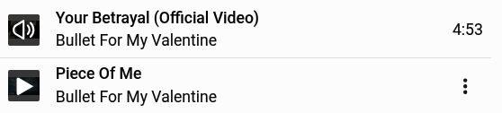

# Pear Desktop White Theme

**Light Crimson** is a CSS theme for [Pear Desktop](https://github.com/pear-devs/pear-desktop), with near-white surfaces, dark text, and crimson (`#DC143C`) accents.

[**Download the latest theme**](https://github.com/seba970423/pear-desktop-white-theme/releases/latest/download/youtube-music-light-crimson.css) · [Release notes](https://github.com/seba970423/pear-desktop-white-theme/releases) · [CSS source](youtube-music-light-crimson.css)

## Preview

## Features

- Matching light backgrounds for the player bar, account menu, song menus, search suggestions, and Share dialog.
- Black titles, artist names, durations, and controls in the player and queue.
- Crimson seekbar, slider knobs, loading indicators, and Premium download badge.
- Correct colours for cover art, video, avatars, and social sharing icons.
- A readable Music wordmark and a visible account-menu border.
- Dark thumbnail overlays with white playback icons, without the pale wash over cover art.

## Install

1. Download **`youtube-music-light-crimson.css`** from the [latest release](https://github.com/seba970423/pear-desktop-white-theme/releases/latest). Keep it in a permanent folder.
2. In Pear Desktop, open **Options → Visual Tweaks → Theme → Import custom CSS file**. Some versions call the menu **Themes**.
3. Select the downloaded CSS file.
4. Reload or restart Pear Desktop.

Use this as the only active colour theme. If an older light theme is listed in the Theme menu, select its entry and confirm **Remove** before importing this one.

No build, installer, or additional dependencies are needed.

## Update or remove

To update, download the new release, remove the old theme entry, import the new file, and reload Pear Desktop. Replace the complete CSS file; do not append it to an older version.

To return to the default appearance, open **Options → Visual Tweaks → Theme**, select this theme's file entry, confirm **Remove**, and reload Pear Desktop.

## Compatibility and feedback

Verified in Pear Desktop on Linux during development. Other platforms and desktop clients have not been verified. The theme styles the YouTube Music content; the operating system controls the native title bar and application menu.

YouTube Music can change its interface independently of Pear Desktop. If something looks wrong, [open an issue](https://github.com/seba970423/pear-desktop-white-theme/issues) with your Pear Desktop version, operating system, theme release, and a screenshot of the affected area. Mention any other active appearance plugins.

## How it works

The theme inverts the dark interface once, then restores media and selected controls separately. Accents outside those restored elements use inverse source colours, so the turquoise-looking `#23EBC3` values in the CSS display as crimson `#DC143C`.

## Publishing a release

Bump the `vX.Y.Z` version in the CSS header and add a matching section to [CHANGELOG.md](CHANGELOG.md). Push both changes to `main`; the release workflow creates the tag and GitHub release, then attaches the exact CSS file from that commit. Existing releases are left unchanged.

## License

[MIT](LICENSE) © 2026 Seba. YouTube Music logos and media artwork remain the property of their respective owners.
